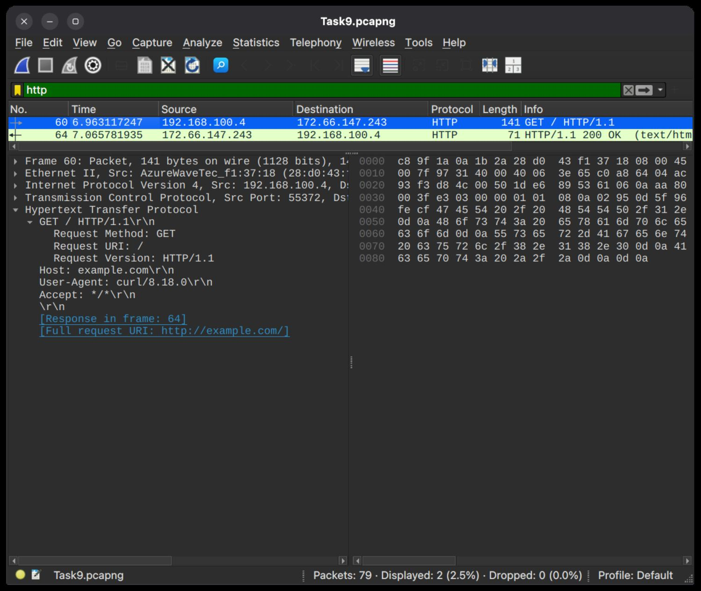
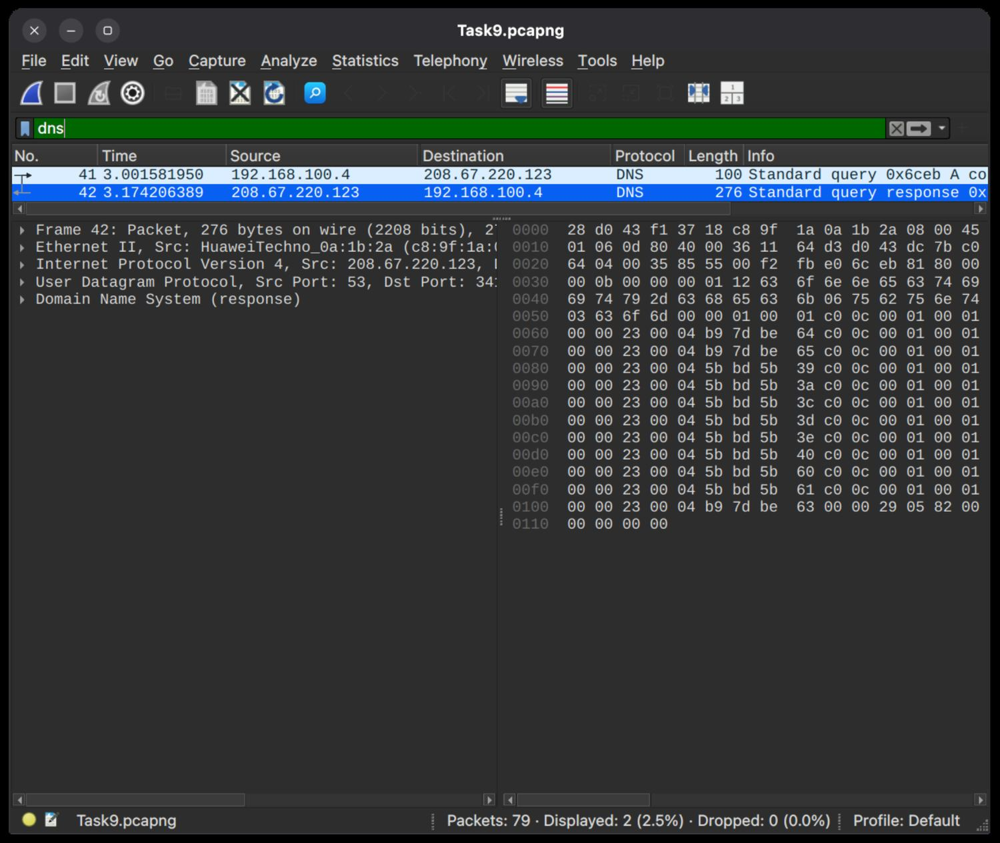

# Wireshark Network Traffic Analysis

A hands-on review of a short Linux-host network capture using Wireshark. The investigation uses display filters to isolate DNS and HTTP traffic, inspect a TCP handshake, and distinguish ordinary traffic from items that would need more context.

## Lab and capture scope

- **Platform:** Ubuntu Linux host
- **Tool:** Wireshark
- **Capture:** `Task9.pcapng`
- **Capture summary:** 79 packets captured; 0 packets dropped
- **Capture host address shown in the trace:** `192.168.100.4`

This is a short, single-host capture made for learning and analysis. It is not a representative baseline for the network.

## Filters and results

| Display filter | Result in this capture | What it helped inspect |
| --- | --- | --- |
| `http` | 2 packets (frames 60 and 64) | The HTTP request and its response |
| `dns` | 2 packets (frames 41 and 42) | A DNS query and its response |
| `ip.addr == 192.168.100.4` | 79 packets (all captured packets) | Traffic involving the capture host |

## Findings

### DNS: frames 41–42

The DNS filter shows a query from `192.168.100.4` to `208.67.220.123` and the corresponding response. The queried name in the capture is `connectivity-check.ubuntu.com`, consistent with an Ubuntu connectivity check. The response is visible in the trace; this exchange alone is not evidence of malicious activity.

### TCP handshake and HTTP: frames 57–64

Frames 57–59 show a TCP three-way handshake between `192.168.100.4:55372` and `172.66.147.243:80`:

1. Frame 57: SYN from the local host
2. Frame 58: SYN/ACK from the remote endpoint
3. Frame 59: ACK from the local host

Frame 60 then contains `GET / HTTP/1.1` with `Host: example.com` and a `curl/8.18.0` user agent. Frame 64 is the corresponding `HTTP/1.1 200 OK` response. Because this test used plain HTTP, the request and response headers are readable in the capture. This is an example of why HTTPS should be used for real web traffic; the capture does not show credentials being submitted.

### TCP retransmissions: frames 45–56

The packet list also shows repeated TCP SYN retransmissions to remote HTTPS endpoints on port 443. Retransmissions can happen when a response is delayed or not received during the capture. They are worth investigating in a broader review, but this short trace does not establish why they occurred or prove an attack.

## Evidence

### HTTP response (frame 64)

### HTTP request (frame 60)

### DNS filter

### Host traffic filter and TCP handshake

## Scope and limitations

- The conclusions above describe only the packets visible in this short capture.
- A retransmission or an unfamiliar address is an observation to investigate, not a verdict by itself.
- The original `.pcapng` capture file is not included in this repository. The published evidence consists of the Wireshark screenshots available from the analysis.
- The TryHackMe room **Wireshark: The Basics** was subscription-locked during the task. The free **Traffic Analysis Essentials** room was completed as the documented learning alternative; the hands-on packet analysis was performed locally in Wireshark.

## Skills demonstrated

- Applying Wireshark display filters
- Following DNS query/response and TCP connection flow
- Reading HTTP request and response fields
- Reporting network observations with appropriate limits
